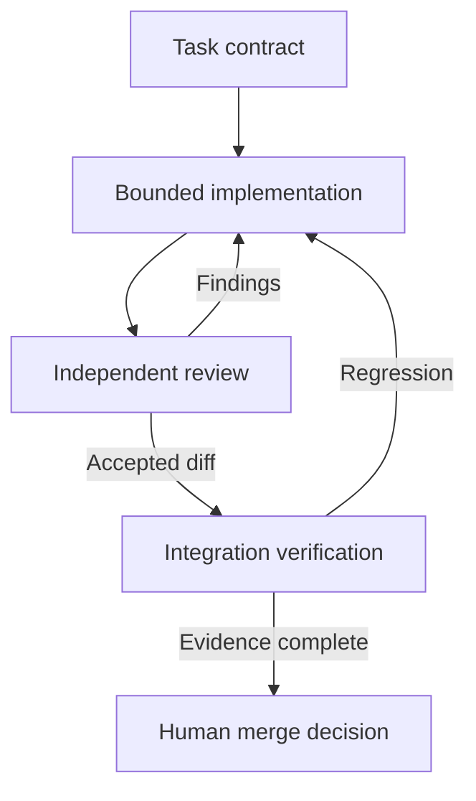

# Agent platform and software factory implementation map

14 November 2026 · Design proposal, not an activated runtime or deployment.

Source audit: checkout `610c4d672d9112c9090b0de47eeeb077d75a3a5a` on
`feature/hosted-persistence-assets`, initially clean. This plan supplements the
[product brief](product-brief.md), [architecture](architecture-plan.md),
[build plan](build-plan.md) and [enterprise boundary](tenancy.md). It does not
replace their implemented contracts or move the application deadline.

## 1. Direction and work boundaries

Keep the Python modular monolith, React workspace, one application command path,
exact approvals and zero-cost offline demo. Build a separate **Agent workspace
and creative production** workstream alongside enterprise epic #34. Its product
goal is a shared project where people and an agent develop a brief, maintain
versioned campaign guidance, produce reviewable creative, and inspect what the
agent did and learned. Enterprise work supplies the hosted identity, storage,
execution, provider and operational foundations.

The software factory is the development process around this repository. It is
separate from the campaign agent that customers use. Development agents' repository
skills are not automatically product-runtime skills.

The existing portable release and Monday 16 November application packaging stay
independent of this larger roadmap. No inference, creative spending, account
provisioning, deployment or customer migration is performed by this design task.

## 2. What exists, and what is missing

These are source-inspected capabilities, not new live verification results.

| Area | Implemented boundary | Gap / action |
| --- | --- | --- |
| Capability discovery | Eleven declared main-model tools in `agent/planning_models.py`; a short capabilities reply in `agent/replies.py`; application-driven delivery review paths in `agent/planner.py` | No authoritative user-facing catalogue joining tools, availability, prerequisites, effects and evidence. Add an explicit registry and scoped projection. |
| Tools | JSON schemas, one requested call per model turn, dispatcher checks, campaign commands shared with UI | Effect metadata and availability checks are distributed. Register tools explicitly and reject unregistered tools by default. Preserve command-side checks. |
| Skills | A substantial embedded planner prompt; domain rules, approved instruction components and two authored viewing contexts | No versioned product skill lifecycle, project guidance store or skill resolver. `.agents/skills/` governs coding agents only. |
| Verification | Strict parsing; permitted IDs/components; scoped sources; package/evidence freshness; verified experiment assessments; code-generated factual replies | No general creative quality pipeline or published validation contract. Keep domain validators; compose their results at acceptance/presentation boundaries. |
| Read/write authority | Access port plus current product grants; `draft_permission` gates placement and instruction revisions; approvals/setup are separate commands | Read-like tools can still persist a review or validate setup. Catalogue effects accurately; add explicit grants for guidance and creative production. |
| Conversations | Durable `planner_sessions` and `planner_messages`, actor/client/brand/campaign binding, ordered follow-ups and model pinning | No project-level collaboration or conversation sharing policy. Preserve existing private actor ownership until explicitly extended. |
| Execution | `agent_runs`, `planner_jobs`, `planner_turns`, `agent_steps`; reservation/receipt before execution, atomic draft/result saves, supersession | Sequential HTTP progress, not an unattended durable worker. #38 owns leases, deadlines, cancellation, recovery and cumulative budgets. |
| Memory | Bounded recent dialogue; persisted buyer corrections; current campaign facts reloaded by tools | No general project context assembler, knowledge lifecycle or user preference catalogue. Extract only as new consumers need them. |
| Learning | `InstructionTests`, `instruction_policy.py` and `InstructionFindings`: evidence snapshots, Bayesian decision, retirement, fresh-brief reuse checks | A narrow comparison-instruction learning loop, not autonomous creative optimisation. Current retrieval remains within the source campaign, even for a fresh brief. Cross-campaign sharing is new policy. |
| Model providers | OpenRouter adapter, configured free-model IDs, composer model picker, bounded requests and receipts | Server environment key only; no dynamic catalogue/BYOK UI. Hosted composition constructs a runtime without live-model configuration. |
| Creative | Fixed versioned editing/audiobook examples, permitted local media, neutral instruction revisions, private immutable asset catalogues | No runtime creative brief, generated voice production, upload onboarding, timeline assembly or generated-asset acceptance pipeline. |
| Projects and sharing | Client → brand → workspace mapping and campaign ownership | No project entity, project membership/sharing experience or arbitrary campaign onboarding. Add these without changing existing tenant identities. |
| Deployment | Authored hosted-access fixture; SQLite plus private files and verified whole-store recovery | Real issuer/Gateplane integration, Postgres/object storage and deployed operational evidence remain open. |

### Current main-model tool catalogue

All tools produce journal records. Below, “write” describes the business effect,
not routine run auditing. Availability depends on current application access and
state; existence of a tool schema is not permission to execute it.

| Tool | Business effect | Important limit |
| --- | --- | --- |
| `read_campaign` | Read brief, policy, placements and correction references | Bound campaign, current access; bounded placement projection. |
| `inspect_catalog` | Read a bounded preview of the bound catalog | Not arbitrary web browsing or arbitrary catalog selection. |
| `classify_catalog` | Compute classification and save specialist receipt | Current planner specialist is simulated, including its accuracy label. |
| `validate_campaign_setup` | Validate and persist a simulated paused setup for review | Requires approved package and setup access; never creates or launches ads. |
| `review_performance` | Read evidence and save a review | Pinned sample delivery and observed local activity remain distinguishable. |
| `load_experiment_evidence` | Read assigned experiment outcomes | Bound experiment, versions, cohorts and correction. |
| `assess_instruction_experiment` | Save an application-validated assessment | Reason code must agree with evidence; not arbitrary analytical prose. |
| `prepare_next_test` | Save an unapproved instruction revision | Explicit instruction draft permission, eligible evidence and keep-takes correction. |
| `save_placement_draft` | Save an unapproved placement revision | Explicit placement draft permission, valid classification and source IDs. |
| `ask_clarification` | End with a supported question | Current reasons are constrained, not general conversational brief building. |
| `respond` | End with application-rendered factual wording | Supported topics; cannot claim unexecuted actions. |

Delivery report review and next-test recommendation also have application-routed
paths in the planner. Finding application is an application command used by the
workspace; `apply_instruction_finding` is listed in the draft-permission map but
is not one of these eleven advertised model tools. Public YouTube search and
the optional Jev probe exist separately in placement review; their presence does
not establish live autonomous search/classification in the main chat loop.

## 3. Capability, skill, tool and verification contracts

A **capability** is a user outcome, such as “prepare a contextual voiceover.” A
**skill** supplies the versioned method and task-specific guidance. A **tool** is
a typed executable operation. A **validator** establishes which properties of a
proposal or result are supported. The model composes these inside the application's
authority; none of them grants authority merely by appearing in a prompt.

Start with core capabilities: discover placements, co-create a brief, prepare
contextual creative, prepare campaign handoff, review performance, propose a
controlled experiment and retrieve eligible learning. Show each as available,
offline-only, blocked with a reason, or planned. Do not advertise planned tools
as usable. The catalogue and the agent's “what can you do?” answer should derive
from the same scoped registry.

An explicit capability definition should contain:

- Stable ID/version, user description, sample requests and supported outputs.
- Required tool IDs and core skill version; allowed project guidance types.
- Required grants, prerequisites, effect classes and supported execution modes.
- Validation/evaluation references and resource limits.

A tool definition should bind its schema, handler, effect class, access checks,
idempotency/recovery behavior, limits and result schema. Derive the model's visible
schemas from explicit registrations and current eligibility. Recheck at dispatch
and at a durable commit. Existing `draft_permissions.py` is a revision-grant map,
not a complete classification of all persistent writes. Avoid expanding it by
treating every unlisted tool as harmless.

Use four effect classes: private read; derived-record write (review/evidence);
draft/content write; external effect (paid generation, publication, ad changes).
Read-only still requires access and data-egress policy. Grants for saving derived
records need not add confirmation dialogs to every analytical turn. Paid creative
generation needs a bounded spend mandate; approval of the resulting creative and
approval to change an ad account remain separate.

Verification stays layered:

| Boundary | Checks |
| --- | --- |
| Input / model proposal | Size, schema, allowed operation, exact IDs, supported arguments; reject executable instructions embedded in imported material. |
| Command / commit | Current identity/access, tenant/project/campaign ownership, revision, evidence freshness and expected approved inputs. |
| Creative acceptance | Approved claims and sources, required qualifications, rights/voice permission, MIME/bytes/hash, duration and required render dimensions. |
| User presentation | Factual status from durable records and receipts; distinguish proposal, saved draft, approved, dispatched, received and verified. |
| Quality evaluation | Context fit, understandable CTA, perceived speech quality and useful brief questions; independently authored examples and human review where judgment is needed. |

An optional model critic can flag unsupported language or weak creative. It
cannot prove factual truth, media rights, successful execution or permission.
Current code-owned wording is a strong protection; broad conversation should add
separate channels for verified facts and unapproved creative proposals rather than
replacing it with unrestricted assistant assertions. Stream progress safely;
publish factual completion only after acceptance. Label draft creative previews.

## 4. Module ownership and state model

These are logical modules within one application, not separate services. Create
new files when a slice supplies a caller; avoid moving every file before delivering
behavior.

| Owner | Existing code to retain | Addition / focused refactor |
| --- | --- | --- |
| Agent runtime | `agent/planner.py`, `run.py`, `conversations.py` | Explicit registry, execution context and shared dispatch checks; later worker integration through the same commands. |
| Context and guidance | Brief/policy snapshots in `scripts/campaign_drafts.py`, current planner prompt | `knowledge.py` / runtime skill definitions and a bounded context assembler with pinned references. |
| Projects | `workspaces.py`, access port and campaign owners | `projects.py`: brand-owned projects, campaign links, project resources and sharing commands. |
| Creative production | `creatives.py`, immutable `assets.py` | `creative_production.py`: briefs, scripts, voice requests, artifact lineage and acceptance; a separate speech adapter. |
| Evidence and learning | `performance.py`, `instruction_tests.py`, `instruction_policy.py`, `learning.py` | Explicit read contracts and candidate guidance proposals. Preserve evidence math and eligibility checks. |
| Providers | OpenRouter adapters and `MainModel` protocol | Narrow model-catalogue, inference-credential and speech-generation contracts; transport independent of process-global key lookup. |
| Persistence | Native command transactions and immutable snapshots | Caller-owned repositories/unit of work for the selected hosted database; preserve atomic writes across run and domain records. |
| Presentation | React chat/composer, campaign workspace, public viewer | Capability discovery, account/provider connection, project resource tree, brief review and creative/evidence cards. |

Proposed hierarchy: **client/tenant → brand → workspace → project → campaigns**.
A project initially stays within one brand; cross-brand projects are deferred.
Existing campaigns can be linked through a migration that preserves campaign IDs,
ownership, revision JSON and approval fingerprints. Do not retrofit new fields into
old content fingerprints. Record a project/run context manifest alongside existing
snapshots where necessary.

Projects are logical resource collections, not filesystem directories exposed to
the model. The UI may present a familiar folder tree containing briefs, guidance,
creative and reports. Do not grant Bash, arbitrary paths, package installation or
network tools to implement that metaphor.

Minimum new records: projects; campaign/project links; versioned briefs;
guidance documents and versions; run context manifests; artifact versions and
lineage; generation operations and validation reports. Every native record needs
an unambiguous tenant/brand/project relationship, creator/updater actor, timestamps
and source references. A user ID records attribution; it does not replace tenant
ownership. Sharing intent/resource relationships belong to the product; current
membership and authorization remain composed through Gateplane's accepted contract.
Do not create a second independent membership authority.

Initial collaboration roles are project viewer, editor and reviewer/manager,
mapped into concrete Gateplane/product capabilities during #36 integration.
Recheck sharing revocation for reads, writes, media and pending jobs. Share project
artifacts by project access; keep conversations private until explicitly shared.
Never share a person's model credential through project access.

### Guidance versioning and learning

Keep core application skills maintained with the application. Let users and agents
co-author **project guidance documents**: approved claims, brand voice, audience,
context, creative preferences, measurement plan and prohibited content. This gives
users useful skill customisation without installing arbitrary executable code or
rewriting the core security instructions.

Each version has a parent/version ID, content hash, scope, author (human/agent),
provenance/evidence, lifecycle state and approval actor. Agent-authored changes
start as proposals; a permitted human publishes an effective version. Human edits
also create versions. Use optimistic concurrency and show a diff on conflict;
avoid last-writer-wins. Rollback points to a new approved version rather than
deleting history. In-flight runs retain their original versions, while current
access and mandatory safety/brand constraints are rechecked before later effects.

Context precedence is fixed application constraints, current mandatory tenant/brand
policy, approved project guidance, campaign brief, current request and retrieved
observations. None can expand tool authority. User guidance is scoped data, even
when called a skill. Imported or learned content cannot self-publish, grant access,
change billing targets or bypass review. Handle contradictions explicitly.

## 5. Sessions, context, memory and learning

Separate these identities:

| Identity | Lifetime and purpose |
| --- | --- |
| Staff login session | Authenticated access, expiry, logout and revocation. Current fixture is not a real issuer integration. |
| Browser provider session | Temporary access to one user's OpenRouter credential; independent of project sharing. |
| Conversation | Durable scoped dialogue. Existing ownership includes actor and campaign, with the model pinned. |
| Run | One user request with pinned scope, model, guidance/evidence versions, permissions and limits. |
| Inference attempt | Reserved external request with outcome and sanitized receipt, independently recoverable. |

Current dialogue uses up to 20 recent messages and an 8 KB serialized context
budget, with a 32 KB full provider envelope, eight planner turns and 512 output
tokens per request. It marks omission rather than silently treating a shortened
history as complete. Extend these as capability-specific limits, with explicit
compatibility rules, rather than removing all caps for long briefs.

Memory should have defined ownership, retrieval and retirement rules, but does not
need a generic memory microservice or vector database now:

- Conversation memory is dialogue context, never verified state or approval.
- Project knowledge is deliberately approved/versioned material.
- Human corrections/preferences carry source and intended scope, and remain
  distinct from measured outcomes.
- Campaign observations and learned findings retain metric, denominator, cohort,
  uncertainty, source versions and freshness. A finding proposes a change; it
  does not demonstrate universal performance or authorize publication.

Build a context manifest from allowed IDs in one consistent read: campaign,
project, policy, skill, guidance, corrections and eligible findings. Apply a byte
budget, deterministic priority and omission markers. Re-fetch current facts before
acting. Add indexed scoped relational lookup first. Semantic retrieval becomes
justified when document volume and measured retrieval failures warrant it.

First cross-campaign learning extension: explicitly promote a finding to the
project after review, preserving source lineage and applicability conditions.
Do not simply remove `campaign_id` from existing queries. Recheck source retirement,
permissions, compatible context/media/metric and current constraints on reuse.
Whether a durable promoted finding survives loss of access to its source must be
an explicit product policy; initial rule is fail closed pending reauthorization.

## 6. OpenRouter and user-funded inference

### What to reuse from iwoca

Read comparison sources: `iwoca/frontend/src/openrouter-session.ts`,
`OpenRouterSettings.tsx`, `src/acquisition/workspace_models.py` and
`docs/model-integration.md`. Current iwoca keeps the key in a server-memory
connection for five idle minutes; browser `sessionStorage` contains the handle,
binding and selected model. Its code removes credentials left by an earlier
browser-storage implementation. It also caches the catalogue, checks price tiers
and binds resumed work to its original provider connection. Reuse the product
interaction and policy ideas, not its process-local connection map on serverless.

### POC credential decision

The requested product constraint is no platform-funded LLM calls and no durable
server storage of customers' keys. A viable stateless POC design is:

1. Account control opens “Connect OpenRouter”; show that OpenRouter bills the user.
2. Retain the key only in the active tab's memory. If surviving reload is required,
   offer explicit tab-session retention in `sessionStorage`; it is accessible to
   JavaScript and is not a secure credential vault. Browser restore behavior means
   tab closing is not a guaranteed secure-erasure mechanism.
3. Send the credential over HTTPS only to the same-origin inference step needing
   it; the server uses it transiently to call a fixed OpenRouter endpoint. Apply
   authenticated session, CSRF/origin checks and scope before any dispatch.
4. Never place the key in URLs, prompts, run snapshots, analytics, errors, queue
   payloads, exports or logs. Redact the credential header/body at ingress and
   tracing boundaries, not just in Python exceptions. Clear the input immediately
   after connection; disconnect/logout/expiry clears browser state.
5. Bind accepted work to the authenticated actor and a server-derived credential
   fingerprint, plus pinned model/policy/limits. Verify key changes on resume;
   never persist the raw key or accept browser-supplied billing identity. Keep the
   binding internal and exclude it from model context.

Browser-only persistence does not mean the server never sees the key. Direct
browser-to-provider execution is an alternative, but it would require a separate
design for binding proposals and authenticating execution evidence; it is not the
default because application-owned reservations and receipts already exist here.

No credential means offline mode or `waiting_for_credentials`, with no developer
key fallback. A closed tab cannot authorize new model calls. Durable records and
already obtained results remain recoverable; resuming a new inference requires
the original compatible credential session or an explicit new operation. #38
must acknowledge this foreground-inference limit. Truly unattended inference
later requires an accepted short-lived credential broker or encrypted secret
store/delegation design; a process-memory map cannot provide it across replicas.

### Model catalogue and dispatch

Use OpenRouter's models API to populate chat selection, filtered by tools,
required tool-choice/structured-output support, modality, price and privacy policy.
The speech picker is separate. Cache public metadata, paginate/search the UI,
preserve the offline model, and show unavailable models with an explanation.
Catalogue presence alone is insufficient: smoke-test shortlisted models against
the application's one-call/schema contract. Do not make every catalogue entry a
supported agent model.

Resolve selection on the server; pin model ID, endpoint, routing, privacy policy,
prompt version, price ceiling, credential binding and budgets on each run. Changing
the model starts a new conversation initially, matching current behavior. The
shared OpenRouter transport should take a request-scoped credential dependency;
do not mutate `os.environ` per user or let a model select an API hostname.

Reserve worst-case cost before calls, including input/output bounds and concurrent
requests. Use provider-enforced price/key limits where the endpoint supports them;
record reported actual usage and reconcile unknown outcomes conservatively. Audio
uses its own units and reservation strategy. A post-response cost check cannot
prevent overspend. Disable automatic paid/provider fallbacks unless expressly
allowed within the pinned routing and data policy. Enforce per-actor/tenant
concurrency and rate caps even with BYOK: server compute and data egress still cost.

Later paid accounts should reference encrypted tenant/user provider connections
or platform-funded entitlements with usage ledgers. `.env` is appropriate for
deployment-wide configuration and server secrets, not one plaintext customer key
per user/payment tier. Billing tier and current authorization remain independent.

## 7. Creative production: first useful vertical slice

Deliver voiceover first, using the two existing contexts and permitted visual
material. General image/video generation and a timeline editor are later work.

The conversational brief captures objective, audience/context, product facts and
approved claims, CTA/destination, required qualifications, format/duration, media
rights, voice/language and production limit. Ask only unresolved material questions.
Render a structured brief card for review; save a version through the same command
the optional form uses. Conversation and forms are two editors of the same model.

The production skill composes a script/delivery plan from pinned guidance and
facts. Tools save an unapproved script, estimate voice generation, dispatch the
specifically authorized speech operation and register validated audio. An artifact
records source brief/guidance/skill versions, exact script, model/voice/settings,
request/receipt, usage, validation report, content hash and reviewer decisions.
Separate creative artifacts from approvals to use them in a campaign package.

Suggested lifecycle: brief draft → reviewed brief → script proposal → authorized
generation → received bytes → validated artifact draft → reviewed creative →
campaign package approval. This is a logical lifecycle; combine routine review
steps in the UI where authority permits. Generation approval allows spending,
not publication or ad activation. A late result after cancellation can be retained
for reconciliation without being promoted into the current campaign.

Use OpenRouter's speech endpoint behind a `SpeechGeneration` port, separate from
chat JSON transport. ElevenLabs currently has models on OpenRouter, and the speech
API returns audio bytes. Validate error JSON versus audio, format, size, duration,
hash and expected voice/model. Preserve supported model/voice pairings. If a
request times out after possible dispatch, do not blindly pay for a replacement.

The authorised experiment ceiling is **£4 total**, not per task or worker. Before
live execution, record current USD pricing and a conservative conversion/fee
allowance against the remaining GBP cap, plus provider key limits if supported.
Use two short takes of one approved script, serial requests and cached artifacts;
reserve headroom for uncertainty. Do not start live calls if the bounded cost
cannot be established. This plan makes no such calls.

Audio is a generated asset, not a complete contextual video ad. Reusing the
existing footage requires its rights and composition assumptions to hold; a
video artifact later needs its own assembly/render adapter and validation.

## 8. Deployment decision within epic #34

Vercel + Neon is a credible candidate architecture, with the following conditions:

| Layer | Candidate | Required work / evidence |
| --- | --- | --- |
| Workspace frontend | Existing Vite build on Vercel | Production routes, account UI, secure headers, no secret injection into frontend bundles. |
| Staff/public API | Existing Python/Starlette ASGI composition on Functions | Deployability spike; trusted proxy/host/scheme behavior; separate staff/viewer origins as current contract requires; short bounded request execution. |
| Durable data | Neon Postgres | Command repositories/unit of work, migration/import, concurrency and history parity. Not a database URL substitution. |
| Private artifacts | Neon Object Storage candidate | Regional availability, private buckets, scoped server credentials, upload acceptance and authorized downloads. Keep logical object keys separate from user paths. |
| Jobs | Durable job records plus selected worker/queue adapter under #38 | No reliance on a live browser or warm function for durable scheduling; inference still pauses without its permitted credential. |
| Identity | Accepted Gateplane/issuer integration under #36 | Real subject binding, current membership/decisions, expiry/revocation, project resource authorization. |
| Operations | #40/#41/#42 | Redacted audit, quotas, preview isolation, monitoring and restore/rollout evidence. |

The current verified topology is one SQLite worker with private durable files.
Vercel functions have ephemeral writable scratch, so neither the database nor
private artifacts can remain there. Native code uses `sqlite3`, `BEGIN IMMEDIATE`,
PRAGMAs, SQLite JSON functions and row ordering, plus filesystem atomic operations.
Port one owning command at a time through a real transaction boundary. Preserve
historical JSON bytes/fingerprints; change physical schema/queries explicitly.
Use versioned one-way migration/import with a verified backup and rollback plan,
not improvised dual writes. Migrations run as a controlled release step, not in
every request constructor.

Use Postgres constraints, expected-revision updates and row locks where needed.
Pool connections and keep API/database regions close. If adding RLS, exercise it
under the actual non-owner application role, with transaction-local tenant context
and no connection-pool leakage. RLS supplements command authorization. Avoid
passing the browser a privileged database or object-store credential.

Neon's current official docs include branch-aware Object Storage and a Free
allowance; evaluate it before adding another provider. Its storage regions are
limited, so region selection affects API/database latency and data location.
Private short-lived media links must be bound to an authorized artifact/publication;
signed links have residual validity until expiry, so do not claim instant revocation.
For strict revocation use an authorization-checking serving path. Large uploads
should go directly to private staging storage with short-lived constrained grants,
then be validated before artifact registration. Current Vercel ordinary body size
limits are below the local adapter's 64 MiB asset bound.

Neon metadata and objects branching together is useful for previews, but never
fork real customer secrets into developer environments. Use authored fixtures,
separate preview credentials and branch lifetime limits. Object/database restore
must be tested as a coherent product recovery, including revoking stale authority
and reconciling already dispatched provider effects.

Vercel's pricing guidance still describes Hobby as personal/non-commercial;
commercial pilots cannot assume free Hobby eligibility just because revenue is
zero. Keep the personal demonstration distinct and resolve hosting plan/terms
before activating a customer pilot. Free service allowances are capacity limits,
not an enterprise availability guarantee. No hosting account is selected here.

## 9. Delivery slices and enterprise dependencies

The package IDs below are mapped to filed issues in the [factory launch board](factory/launch.md).
Factory epic #47 and agent-workspace epic #48 supplement enterprise epic #34.
Retain its existing issue identities and cross-link shared foundation work rather
than creating duplicate implementations. The table remains a design map, not
proof that an issue has been implemented or dispatched.

| Package | Deliverable and owning files | Dependency | Acceptance evidence |
| --- | --- | --- | --- |
| F0 Factory foundation | Task contract, stage records, reviewer/verifier prompts; release checks including planner build in CI | Existing workflow | One bounded task completes with independently verified acceptance on the exact integration commit. |
| A1 Capability clarity | Registry over existing tools; catalogue API; scoped capability UI/replies | F0; agree effect contract | Every advertised operation maps to a reachable handler; unknown/disabled/foreign requests cannot dispatch; offline/live labels are accurate. |
| A2 Provider/BYOK slice | Credential port and public catalogue; account connection and filtered model picker | A1 contracts; #36/#38/#39 boundaries | Two users cannot substitute credentials; no key in logs/DB/export; missing/expired key sends zero calls; price drift, replay and wrong model fail safely. |
| A3 Projects and collaboration | Brand-owned projects; link existing campaigns; project resources and sharing | #35 model; #36 project-access contract; chosen schema | Two tenants, two members and a revoked member exercise list/read/write/media/job access; old campaign approval identities survive. |
| A4 Brief and guidance | Versioned brief/guidance commands, core skills, bounded context manifest, conversational brief cards | A1 and A3 | Human/agent concurrent edits conflict safely; proposed guidance cannot become effective through model text; runs retain exact versions. |
| A5 Creative voice slice | Brief → script → estimated/authorized speech → private validated artifact | A2 and A4; #37 asset port; #38/#39 receipts and budgets | Offline full journey first; separate live two-take check remains within £4 total; bad bytes and uncertain outcomes cannot become accepted assets. |
| A6 Project learning reuse | Explicit candidate guidance updates and reviewed project promotion | A3/A4; existing learning | Unsupported, stale, retired, incompatible or inaccessible findings cannot alter effective guidance or a campaign; eligible reuse retains source uncertainty. |
| E37/E41 Hosted persistence | Postgres/unit-of-work and private object-store adapters; deploy spike and release procedure | Hosting ADR; #36; current #37 completion | Run/domain transaction atomicity, concurrent revision conflicts, historical snapshot parity and coherent restore on deployed storage. |
| E38 Durable execution | Claim/lease, fenced commits, cancellation, request reservation, deadlines and cumulative budgets | Credential contract; durable store | Crash-before/after-dispatch, duplicate claims, late result, cancellation, access loss and unknown receipt have explicit safe outcomes. |
| E42 Composed pilot | Joined browser → auth → tools → provider → DB/object → verified result | Required product and enterprise slices | Two-client deployed journey, restart/revocation, privacy, cost and performance evidence; no fixture presented as live production evidence. |

Recommended order: F0/A1 first; then A2 and a bounded hosting/persistence spike in
parallel; then A3/A4; then A5; then A6 and the composed pilot. The schema/authority
contracts must be agreed before concurrent work reaches shared migrations. Deploy
a thin vertical slice early, after its dependencies, instead of postponing all
hosting validation until the end. Preserve release packaging as a separate lane.

## 10. Factory execution and quality gates

Start with this thread as coordinator, up to two builders for independent file
ownership, one independent reviewer and one verifier as needed. Research/design
is a bounded task when a decision blocks implementation. These are roles; five
agents need not run continuously. Use separate persistent Codex threads for work
the user needs to inspect/resume, and bounded subagents where supported. A diagram
or task file is not an unattended scheduler; automated dispatch needs an explicitly
implemented coordinator and recovery mechanism.

Each builder gets a separate worktree and branch (`feature/<description>` or
`fix/<description>`), temporary database/blob root, ports and authored fixtures.
Worktrees isolate source files, not secrets, network access or shared services.
Keep provider credentials unavailable to offline workers and supply no access to
customer/employer material. Two workers must not own the same migration chain,
dispatcher or application bootstrap in the same wave.

The coordinator freezes a task contract containing: ID, user outcome, base commit,
dependencies, in/out of scope, file ownership, API/data contracts, protected
invariants, acceptance scenarios, permitted commands/network/cost, and finish
conditions. Each stage records input/output commit, evidence paths, decisions,
failures and next owner. Private logs/databases remain outside Git; only sanitized
authored evidence is committed.



Reviewer reads the diff, contract and reachable alternate writers, and reports
consequences with reproduction evidence. Independent review is separation of
task/context, not a guarantee from using another model. Verifier derives expected
behavior from the contract, not the builder's implementation. Changes after
review require affected review/verification to be refreshed. The coordinator
integrates serially and reruns acceptance on the exact resulting commit. Cap
automatic repair loops (initial proposal: two); return to specification for
ambiguous product choices instead of letting workers expand scope.

Every consequential slice needs deterministic contract/command tests at the
actual trust boundary. Add scenario evaluations for agent quality: ask about
capabilities, co-create an incomplete brief, reject unsupported claims, preserve
a buyer correction, ignore injected catalog/guidance instructions, and propose a
next test only from eligible evidence. Model evaluations supplement offline
fake-provider tests; live tests are separately budgeted and labelled.

Mandatory changed-boundary cases include cross-tenant/project substitutions,
revoked membership during inference, stale revisions/guidance, duplicate requests,
late/cancelled worker results, malformed tool responses, wrong model/credential,
overspend under concurrency, uncertain paid effects, uploaded malicious media,
SSRF in imported URLs and unsafe rendered content. Select cases made reachable
by the slice rather than repeating a generic security suite for every edit.

Performance acceptance starts with measured baselines, not an unsupported SLA.
Suggested initial warm-state target: p95 under 500 ms for scoped application
reads/commands excluding external identity/model latency; report those external
latencies and cold starts separately. Bound context construction, catalogue cache,
transcript pagination, media bytes, database connections and inference concurrency.
Keep provider calls outside write transactions. Confirm blocking provider/SQL work
does not stall the ASGI event loop. Measure first progress, model time, full task
time, DB waits, artifact download and usage, with no private prompt/key logging.

Factory success metrics: human intervention minutes, elapsed delivery time,
review/fix cycles, defects found by independent verification, escaped regressions,
agent usage and any live spend. Compare several similarly sized slices with the
current single-thread process; a small pilot cannot establish statistical gains.

Suggested first task contract:

```yaml
id: A1-capability-catalogue
status: proposed
outcome: A buyer can see what the current agent can do and why an action is unavailable.
base_commit: 610c4d672d9112c9090b0de47eeeb077d75a3a5a
branch: feature/agent-capability-catalogue
depends_on: [F0-contract-and-review-process]
scope:
  - Register existing operations with explicit effects and prerequisites.
  - Project scoped availability into API, capability reply and workspace UI.
out_of_scope:
  - New paid inference or creative production.
  - Changes to package approvals, launch authority or deployment.
protected_invariants:
  - Unknown or unavailable tools cannot execute.
  - UI and agent tools retain the same application command authority.
  - Catalogue text cannot grant a missing permission.
verification:
  - Existing offline suite and planner TypeScript/Vite build.
  - Focused denied/unregistered tool and availability projection checks.
  - Browser inspection of capability states at desktop and narrow widths.
provider_calls: forbidden
merge: human_review
```

## 11. Evidence and remaining decisions

This is a source audit and implementation proposal. The previously documented
206-test storage checkpoint is historical evidence; this task does not claim a
new test run, live inference, deployment or measured performance. Before coding,
refresh the base commit and current enterprise issue/PR state. Issue references
here come from the repository's current documentation, not a fresh GitHub audit.

Decisions already recommended: modular monolith; explicit capability/tool registry;
approved versioned project guidance; no executable user skills; OpenRouter as
inference/speech gateway; no customer key in durable server storage for the POC;
human review of effective learning updates; preserve existing application checks.

Decisions to resolve at their implementation gate: memory-only versus explicit
tab-session key retention; hosting plan eligibility and region; real Gateplane
project authorization contract; exact Postgres migration sequence; credential
availability for unattended jobs; voice/model and bounded cost for the £4 trial;
artifact delivery/revocation policy; cross-campaign finding promotion policy.
They need concrete designs and evidence, not a new blanket approval flow.

Primary external sources checked 14 November 2026:

- [OpenRouter models API](https://openrouter.ai/docs/guides/overview/models): catalogue, supported parameters and output modalities.
- [OpenRouter provider routing](https://github.com/OpenRouterTeam/docs/blob/main/guides/routing/provider-selection.mdx): parameter, fallback and privacy controls; verify endpoint support.
- [OpenRouter credit and request limits](https://github.com/OpenRouterTeam/docs/blob/main/api_reference/limits.mdx): account/key limits and in-flight budgets.
- [ElevenLabs on OpenRouter](https://openrouter.ai/blog/announcements/elevenlabs-on-openrouter/), [model listings](https://openrouter.ai/elevenlabs) and [speech endpoint tutorial](https://openrouter.ai/blog/tutorials/text-to-speech/): current availability and byte-response behavior. Do not reuse expired promotional pricing.
- [Vercel Python/functions runtimes](https://vercel.com/docs/functions/runtimes), [limits](https://vercel.com/docs/functions/limitations), [pricing](https://vercel.com/pricing) and [terms](https://vercel.com/legal/terms): deployment and plan constraints. Older search extracts can differ from current pages; consult the current plan and terms before activation.
- [Neon plans](https://neon.com/docs/introduction/plans), [pooling](https://neon.com/docs/connect/connection-pooling), [Object Storage](https://neon.com/docs/storage/overview) and [storage authentication](https://neon.com/docs/storage/authentication): free capacity, branch-aware files, regional availability and credential boundaries.

External availability does not establish account-specific access, model quality,
permitted media rights, regional suitability or production readiness.
